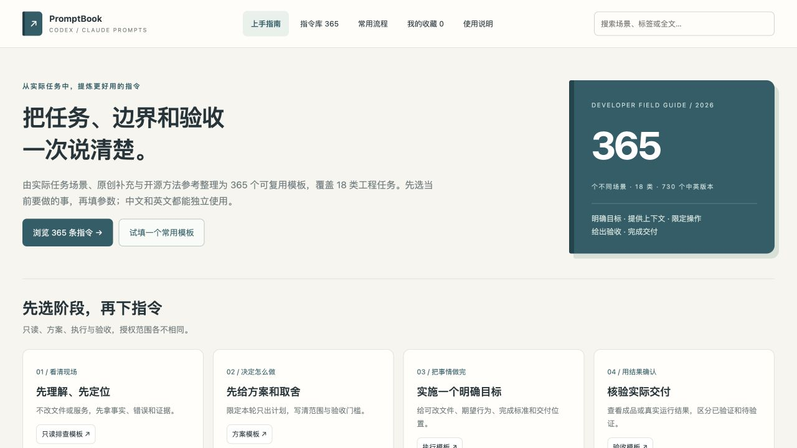
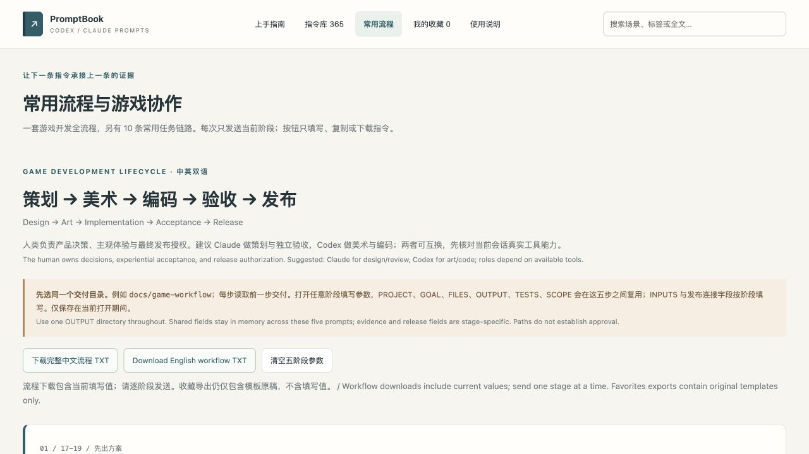

# PromptBook

**帮助你更高效使用 Codex / Claude 的双语指令手册。**

[在线使用](https://g.ismayday.com/tools/promptbook/) · [English](README.md) · [贡献指南](CONTRIBUTING.md) · [来源调研](docs/SOURCES.md)

**365 个任务场景 · 18 类 · 58 个标签 · 中文 / English · MIT**

先选择要完成的任务，填入项目、资料和目标，再复制带有执行边界与验收要求的指令。页面主要使用中文，每条模板都有可独立使用的完整英文版本。



## 快速使用

1. 打开[在线手册](https://g.ismayday.com/tools/promptbook/)，或在 GitHub 的 [`index.html`](index.html) 页面点击 **Download raw file**，保存后用浏览器打开。
2. 搜索任务、关键词或编号，按分类、标签和执行模式筛选。
3. 填写参数，检查未填占位符。
4. 复制中文或英文，核对授权与验收条件后粘贴到 Codex / Claude。

无需安装依赖、注册账户、配置 API key 或连接模型。网页内置全部数据、脚本、样式与公开参考资料，可离线使用。手册负责组织指令，执行仍由目标会话完成。

## 功能与内容

- 任务场景模板，明确目标、上下文、可操作范围和完成标准。
- 六种模式：只读分析、先出方案、本地执行、远端执行、生成交付物、明确的 Git 操作。
- 全文搜索、分类与标签筛选、参数预览、中文/英文/对照查看、复制、下载 TXT、打印、收藏与 JSON 导出。
- 24 条入门推荐，10 条常用任务链路，以及一套五阶段游戏开发流程。
- 保留原有 360 条正文、编号和参数；新增五阶段交接指令，将策划、美术、编码、验收和发布串成可接续的流程。详见[版本说明](docs/UPDATES.md)。
- 开源方法参考显示固定 commit 与许可，和原创补充分开标注。

简单任务可删去当前会话已经确认的背景，保留必要目标与边界即可。模板不会自动赋予工具能力或外部系统权限。

## 游戏开发完整工作流

[打开五阶段流程](https://g.ismayday.com/tools/promptbook/#game-workflow) · [查看可直接复制的全部中英文指令](docs/GAME_WORKFLOW.md)

| 阶段 | 建议分工 | 交付给下一阶段 |
| --- | --- | --- |
| 策划 | Claude 或 Codex | `01-design.md` |
| 美术 | 具备实际生图能力的 Codex；Claude 可整理工单与复核 | `02-art/`、`02-art-manifest.json`、`02-art-review.md` |
| 编码 | Codex 或 Claude | `03-implementation.md` |
| 验收 | 另一会话独立复核 | `04-acceptance.md`、`04-checks/` |
| 发布 | 有仓库及目标服务器权限的指定会话 | `05-release.md` |

五步使用同一个 OUTPUT 目录，例如 `docs/game-workflow`。打开任意阶段填写参数，可直接复制中文或英文。PROJECT、GOAL、FILES、OUTPUT、TESTS、SCOPE 在五步之间共享，INPUTS 和发布连接信息按阶段填写；每步都有输入、交付、通过条件和返工去向。分工可互换，不自动创建代理或向其他会话发送消息。

每次只发当前阶段。完整流程 TXT 下载包含当前填写值；收藏导出仍只包含原始模板。发布前在 SCOPE 中写明本轮提交、推送和部署授权，不能仅凭文件路径推断已经通过人类验收。

## 分类

| 编号 | 分类 | 条数 |
| --- | --- | ---: |
| 01 | 任务启动与协作 | 18 |
| 02 | 调研与技术方案 | 18 |
| 03 | 代码实现与重构 | 18 |
| 04 | 排错、审查与验收 | 18 |
| 05 | Git、同步与归档 | 23 |
| 06 | SSH、网络与本机 | 18 |
| 07 | GPU、环境与服务 | 21 |
| 08 | 训练监控与恢复 | 20 |
| 09 | 模型、数据与实验 | 24 |
| 10 | 图像、视频与素材 | 18 |
| 11 | 文档、报告与知识库 | 23 |
| 12 | 前端、交互与产品 | 18 |
| 13 | 安全、隐私与权限 | 21 |
| 14 | API、数据库与数据工程 | 21 |
| 15 | 测试、质量与发布 | 21 |
| 16 | 代理、工具与上下文 | 24 |
| 17 | 游戏策划、玩法与关卡 | 21 |
| 18 | 游戏美术、音频与发布 | 20 |

上一版会话提炼的检索窗口为 2026-10-24 至 2026-10-29（America/Los_Angeles）。游戏专题补看较早的 GameAI 会话与用户需求，覆盖 **星际突击队、心动陪伴、武林小馆、西游飞行棋、花园三消、StackPop**，包括可解性、轻松难度、点位对齐、图标缩放、iOS 音频、刷新续玩及独立子目录发布。首页新增六款游戏快捷入口与两条游戏流程。



## 隐私与收藏

搜索与填参在浏览器本地运行，不含统计追踪或运行时网络请求。填写值只保留在当前打开期间；收藏存于当前浏览器，导出只包含模板原稿，不包含填写内容。离线文件、不同域名与浏览器配置的存储行为可能不同。

公开内容没有个人原始聊天摘录、会话标识或助手回复，只有参数化改写后的指令。不要填写密码、私钥或 API token。

## 构建与贡献

Python 3.9+，只使用标准库；Node.js 仅用于可选语法检查。

```bash
git clone https://github.com/kevinchenkai/promptbook.git
cd promptbook
python3 build.py
python3 build.py --check
node --check ui.js
python3 -m http.server 8000 --bind 127.0.0.1
```

打开 `http://127.0.0.1:8000/`。只查看手册时不需要执行构建。`--check` 只验证，不改文件；构建无需个人历史目录或在线模型。

编辑 `recipes/01.txt` 至 `recipes/18.txt`，每行用 `¦` 分隔七个字段：中文标题、英文标题、执行模式、标签关键词、编辑检索词、中文正文、英文正文。公共执行边界、验收要求和参数说明由 `build.py` 补齐。已有编号用于收藏与流程，新增条目请追加。

具体格式、来源记录和验证要求见 [CONTRIBUTING.md](CONTRIBUTING.md)。主 [README](README.md) 说明文件结构。内容日期记录在 `curation.json`，不使用构建机器当天时间，便于重复生成一致成品。

## 来源与质量说明

内容结合实际工程场景的精选改写、原创补充，以及 Fabric、Prompt Catalog、OpenAI Cookbook 中的方法参考。已核对许可并记录具体文件与 commit；没有整包搬运开源合集。调研结果、未采用的写法及原因见 [docs/SOURCES.md](docs/SOURCES.md)。

构建检查覆盖编号/标题/正文唯一性、双语参数一致性、来源映射及成品是否最新；本次按约定不运行 Playwright，验证范围为内容结构、脚本语法、构建一致性及发布文件。**未对全部 365 条逐条做模型效果 A/B 测试**，不承诺一次成功，也不代表 OpenAI 或 Anthropic 官方认证。

## 发布与许可

生成的 `index.html` 可单独放到静态服务器。当前网站为 [g.ismayday.com/tools/promptbook/](https://g.ismayday.com/tools/promptbook/)。发布网页不需要上传 Git 元数据、编辑源文件或任何私人记录。

原创项目内容采用 [MIT License](LICENSE)。上游许可保留于 [THIRD_PARTY_NOTICES.md](THIRD_PARTY_NOTICES.md) 和 `licenses/`。欢迎通过 [Issues](https://github.com/kevinchenkai/promptbook/issues) 或 PR 建议新的常用场景、修正翻译或反馈问题。
